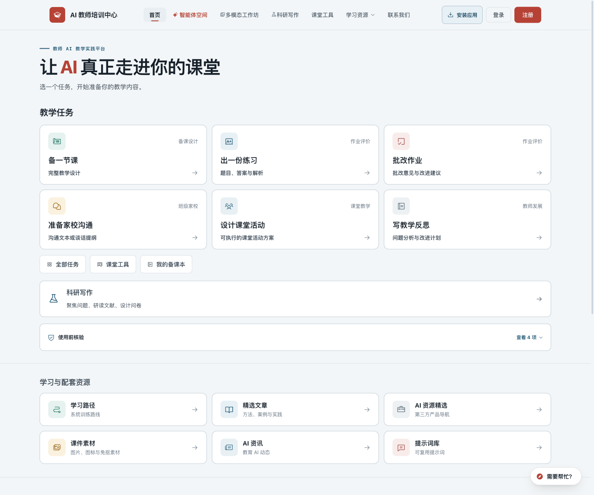
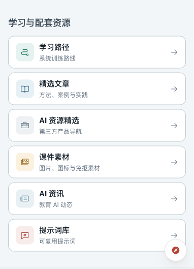

# 首页配套资源视觉统一

状态：用户明确授权上线，2026-10-25 已发布（`dbab84d`）。主站：https://ai.teachailab.com/ 。

预览：`http://127.0.0.1:8765/#home-resources`。手机沿用原按钮展开。

本轮使用 `frontend-design` 与 `ui-ux-pro-max`，以现有教师网站的实际样式为基准。观察到上方是 Phosphor 线性图标，下方是复杂场景缩略图，另有圆角、边框和箭头差异。保留已认可的紧凑布局，把六张图统一为同套 Phosphor Regular 线性图形，直接共用 `.th-task-icon` 样式。

上下卡片均为白底、12px 圆角、同色细边框，图标底板尺寸、圆角和配色一致；右箭头的方向、大小与悬停反馈一致。资源入口仍使用较小的文字，保持桌面卡高 80px、手机卡高 64px，桌面三列、平板两列、手机单列。1440px 时资源卡片区高 172px，主任务约 302px。

六图分别表达学习路线、文章阅读、AI 工具、课件素材、AI 资讯和提示词对话。名称、短说明、链接和手机折叠保留。图形保存在本地 SVG 中，尺寸明确、延迟加载、不重复朗读链接名称；[来源与 MIT 许可](../../assets/home-resources/README.md)。

完整 `npm run check` 通过。隔离浏览器 57 项通过，覆盖 320/375/390/600/768/1024/1440px 的上下样式一致性、主次字号、卡片高度、图片与文字完整性、原链接、键盘焦点/Tab 顺序、悬停稳定性、减少动态效果偏好；脚本错误 0。六图 XML 与无脚本检查通过。当前桌面、手机截图均已实际查看。

[浏览器检查摘要](browser.json)。接口使用模拟响应，阻断外部网络；真实模型、邮件与生产写入均为 0。

生产 SW 已更新为 `20261025-v54-resource-unified`。临时截图、快照与测试上下文已清理；保留用户要求的 8765 本地预览。

## 生产发布（2026-10-25）

用户明确要求上线，功能发布提交 `dbab84d`，SW `20261025-v54-resource-unified`。白名单包包含 184 个静态文件、38 个 API 文件；逐一与服务器比较后，212 个文件一致，仅传输首页、SW 与六图/许可/来源共 10 个变化文件，差异包 34697 字节。候选及正式的完整 222 文件 SHA-256 校验通过。

Release：`/home/ubuntu/t-training/releases/20261025-resources-dbab84d`。完整私有回滚备份：`/home/ubuntu/t-training/backups/20261025-pre-resources-dbab84d`，含原静态、API/依赖、双 Nginx、私密环境、PM2 与事务数据库。备份目录 700、私密文件 600；数据库 gzip 3785482 字节，完整性通过。

38 个 API 源文件及依赖锁文件完全一致，候选使用独立复制的同版依赖并在 3002 验证。候选、正式 3001、公网各 19 项接口守卫通过；部署仅通过 `renameat2(RENAME_EXCHANGE)` 原子交换静态目录，带失败回滚保护。发布前规范静态目录 755/文件 644，并以 Nginx 用户实际读取首页和六图。正式 API 没有重启，双 Nginx 内容没有改动；候选已停止删除并保存仅两站的 PM2 清单。

完整公网检查 170 项通过。线上隔离浏览器 36 项通过：320/390/768/1440px 上下卡片/图形风格一致、紧凑布局、六图加载与 SVG MIME、原链接、键盘焦点/Tab、缓存 v54；脚本错误 0。实际打开并查看桌面与手机临时截图，后台自定义标题与简介保留。验收浏览器禁用 SW 并拦截 `operations-track`，避免虚构访问计数；未使用生产登录会话。

HTTP/2 首页 200、HTML/SW no-cache、JS gzip/30 天缓存、SVG MIME/30 天缓存均通过；旧站路径与参数 302 保留，课程站 200。双 Nginx 上游仍为 3001；API PID 1259773、课程站 PID 4180111 保持不变且 online。systemd active/enabled，MainPID 与 PM2 daemon 均为 1091830。真实模型调用、邮件及生产账号/作品写入均为 0。

[发布与网络证据](production.json) · [线上界面检查摘要](production-browser.json)

已关闭线上隔离浏览器，并清理服务器候选、QA、交换旧目录、上传包和临时脚本，以及本机发布包、运维脚本、临时截图和快照。正式 release 与私有回滚备份保留；既有 8765 用户预览保留。发布记录另行提交并推送，不重复部署静态包。
