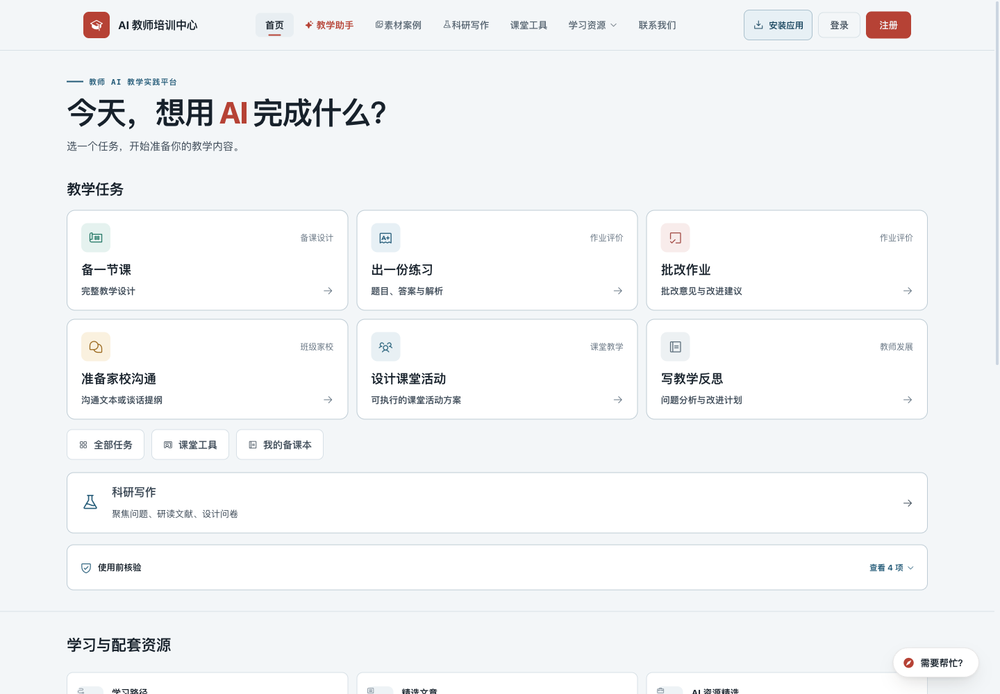
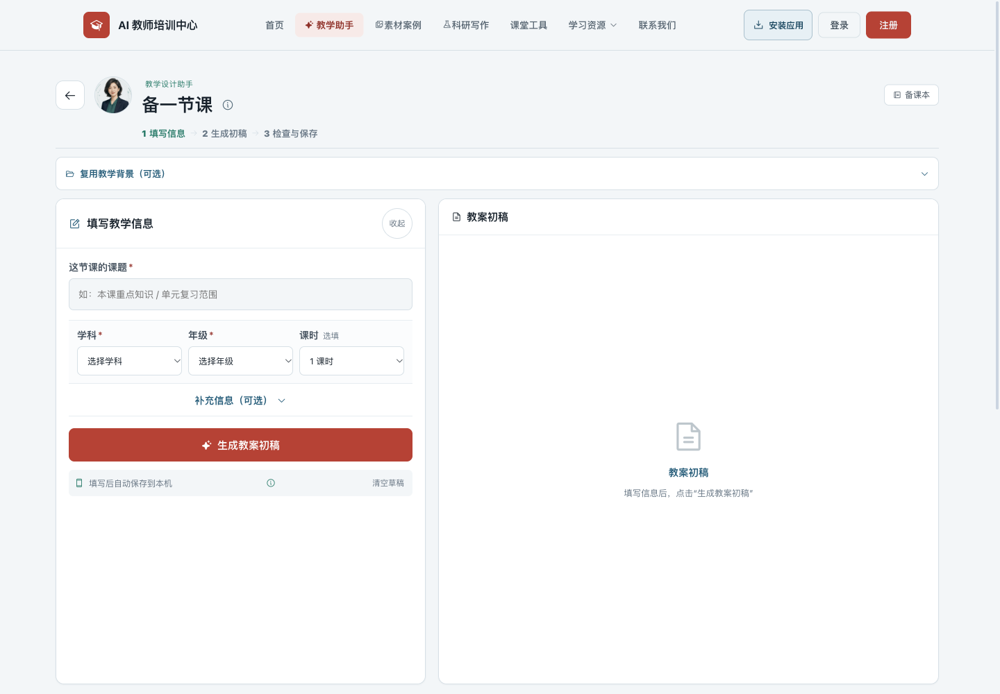
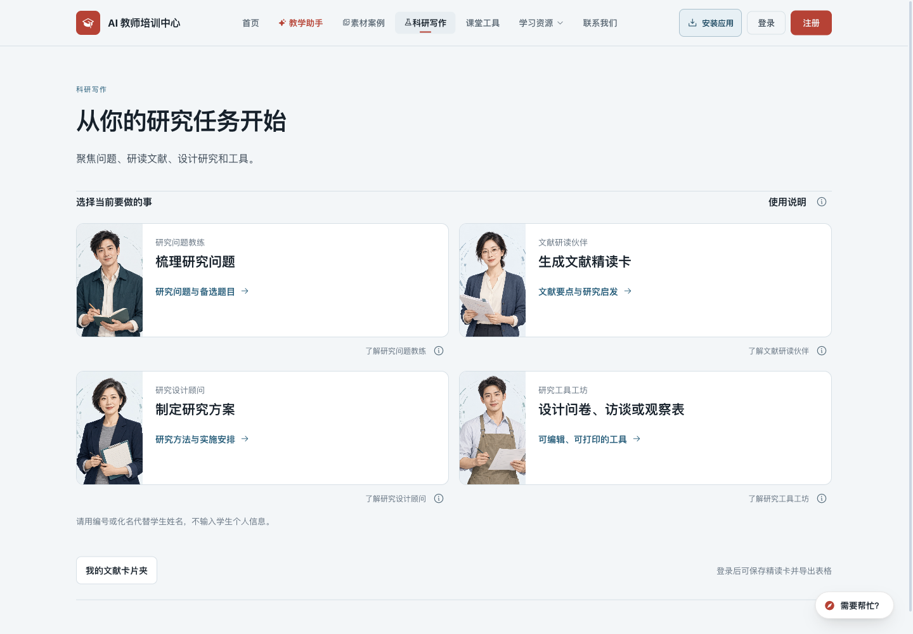

# 2026-10-25 任务入口与备注体验改造

本报告记录首次改造，部分设计已按用户核对结果恢复。**当前实现以 [核对落实记录](2026-10-25-ux-confirmed.md) 为准**；下方截图和 171 项浏览器记录保留为初版历史证据。

初版状态：本地实施与验收通过，未发布。完整回归、浏览器布局与模拟交互、截图检查及静态资源检查通过。

[打开可勾选的修改核对清单](2026-10-25-ux-review.html)（需通过本地预览打开，选择保存在当前浏览器）。

## 目标与设计约束

教师应能从入口判断用途，从主要按钮判断下一步，从操作后的状态判断结果。沿用现有蓝灰、朱红配色、系统字体和人物素材，减少重复说明和同屏决策；主要操作、必填标签、错误及隐私限制保持可见。

本次代码检查发现的负担包括：首页介绍与任务说明重复，功能选择叠加人物/部门/用途，工作台重复解释简报和交付，科研首页三块说明位于功能入口之前，以及保存成功缺少直达具体成果的路径。本轮另按当前 HEAD 复现原界面，逐一查看首页、任务列表、工作台和科研首页的实际截图；对应证据与改造结果见下方。未将这些检查表述为真实教师可用性研究。

## 实施范围

| 路径 | 本地改造 |
| --- | --- |
| 全站导航 | 教学助手、素材案例、科研写作使用直接的用途名称；主导航和安装态名称对应；当前页面增加 `aria-current`。 |
| 首页 | 压缩介绍，六项教学任务直接进入工作台；提供全部任务、课堂工具和备课本入口；入口名称与工作台共用任务映射。移除首页对完整智能体提示词数据的加载，继续使用当前账号的本机任务恢复；只浏览空白工作台不再制造“未完成任务”。 |
| 教学助手列表 | 卡片以“备一节课”“出一份练习”等动作命名，保留人物与角色来源，缩小肖像占用；部门目录按任务选择；说明进入备注。 |
| 17 个表单工作台 | 突出教学信息和交付成果；所有必填项位于可见表单，选填信息折叠；必填下拉先明确选择，沿用已有账号背景与草稿；字段错误就近反馈，题型选择可清除相应错误。 |
| 生成与保存 | 生成中显示实际等待状态和停止操作；手机生成时滚到结果区域；保存成功显示直达当前成果的链接；保存失败在结果区显示，修改后撤下旧的成功状态；本机草稿与备课本保存明确区分。 |
| 科研首页 | 四项具体任务优先；角色介绍、方法说明放入对应备注；仍直接显示学生个人信息提醒；使用现有 300 个后台字段，介绍和自定义文案保留。 |
| 备课本 | 增加新建任务入口、空列表的下一步、筛选为空时的清除按钮；目录/活页切换增加文字与选中状态；`?work=` 在当前账号作品中定位并打开成果。 |
| 课堂工具、社区提示词 | 演示模式、计分板、量规和活动模板的补充说明，以及社区投稿使用说明，改为对象附近的备注；座位互换等必要操作提示继续可见。 |

## 备注组件

新增 `js/ui-notes.js` 与 `css/ux.css`。支持悬停、键盘聚焦、点击固定、再次点击/外部点击/Escape 关闭；提示靠近对象并限制在视口内，允许光标移入阅读。保留已有 `aria-describedby`，原生对话框内的提示仍在对话框中显示。备注读取当前页面内容，后台文案更新后不会使用过期快照。

帮助文字经转义后插入，提示正文使用 `textContent`；没有新增网络请求、浏览器持久化或统计字段。帮助脚本缺失时原说明仍可显示。科研已有备注与通用备注相互关闭，避免两个已固定提示同时遮挡。

## 文案、缓存与数据边界

- `SiteCopy` 只把与旧内置默认值完全相同的文案升级为新默认值，保留管理员自定义内容；字段编号、数量和保存结构不变。
- auth、site-copy、task-search、pwa、assistant、research-presentation，以及新增体验资源的本地查询版本为 `20261025-ux`；本地 SW 为 `20261025-v50`，新增体验资源进入静态预缓存。
- 模型提示词、课程匹配守卫、科研六轮规则、身份权限及 API 数据读写逻辑未变；研究采集继续关闭。
- 本次未发布、未推送、未操作生产数据，未调用真实模型或发送邮件。

## 已完成的验证

- 完整 `npm run check` 通过；既有科研 249 项、来源统计 90 项等回归继续通过。
- 新增 `scripts/test-ux.mjs` 并接入检查：94 项离线断言，覆盖全部 19 项任务映射及搜索、17 个表单的必填项可见性、未来表单的必填保护、动态字段转义，以及备注的聚焦/悬停/点击/Escape/越界/源文案更新/旧说明恢复与移除生命周期。
- 38 个页面内联脚本及改动脚本通过 JavaScript 语法解析。
- 本机 HTTP 检查 61 项通过，包含全部预缓存资源和应用页面。
- `git diff --check` 通过。

- 独立 Playwright 隔离浏览器通过 **171 项**：117 项布局/必填可见性检查与 54 项交互检查，覆盖 320/390/768/1440px、全部 19 项教学任务、搜索、错误顺序、模拟登录后继续、生成等待/停止/服务错误、编辑、保存失败重试、成果直达与账号切换、鼠标/键盘/触屏备注、手机导航与课堂工具演示。脚本错误 0。详见 [机器可读记录](2026-10-25-ux-browser.json)。
- 模拟模型请求 3 次，真实模型请求、真实邮件与生产写入均为 0；测试上下文拦截外部域名、禁用 Service Worker，接口与账号均为虚构数据。

## 截图与页面判断

以下 14 张均在本轮实际捕获并打开检查。原界面由当前 HEAD 的 HTML/CSS/JS 复现，前后使用同样的 1440×1000 视口与公开内容空数据替身。手机为 390×844；成果弹窗使用虚构教师与模拟练习。被登录弹层或临时提示挡住的截图已拒收并重拍。

| 步骤 | 改造前 | 改造后 | 判断 |
| --- | --- | --- | --- |
| 1. 首页选择任务 | [原截图](2026-10-25-ux/01-home-before.png) | [新截图](2026-10-25-ux/05-home-after.png) | 缩短首屏介绍，六项任务、预期成果及后续入口更靠前。 |
| 2. 找到教学能力 | [原截图](2026-10-25-ux/02-tasks-before.png) | [新截图](2026-10-25-ux/06-tasks-after.png) | 人物仍在，入口由任务名称主导；人物与部门不再占据主要篇幅。 |
| 3. 填写与生成 | [原截图](2026-10-25-ux/03-form-before.png) | [新截图](2026-10-25-ux/07-form-after.png) | 课题使用单行输入，主操作明确；空结果不重复一份尚未填写的任务摘要。 |
| 4. 科研选任务 | [原截图](2026-10-25-ux/04-research-before.png) | [新截图](2026-10-25-ux/08-research-after.png) | 四项具体任务优先，原方法说明可按需查看，学生信息限制仍直接显示。 |

手机截图：[首页](2026-10-25-ux/09-home-mobile.png)、[任务列表](2026-10-25-ux/10-tasks-mobile.png)、[教学工作台](2026-10-25-ux/11-form-mobile.png)、[科研入口](2026-10-25-ux/12-research-mobile.png)、[备注展开](2026-10-25-ux/13-notes-mobile.png)、[已保存成果](2026-10-25-ux/14-saved-work-mobile.png)。

## 检查边界与后续

内置浏览器与电脑控制连接失败后，依据用户对常规、可逆开发操作的既有授权，使用独立的隔离浏览器完成本地检查。没有安装浏览器扩展，也没有使用真实账号。

浏览器验证使用模拟认证、模型回复和保存接口，不能代替真实模型内容质量、真实数据库/邮件或上线后的生产检查；尚未进行真实教师首次使用试验，因此不声称已经证明“零学习成本”或完整无障碍合规。真实 PWA 安装与离线切换未在本轮复测。

本地预览、测试上下文、临时 HEAD 基线与工具临时文件在交付前关闭或清理；保留本报告、验收 JSON、14 张已检查截图及正式回归脚本。生产发布须按用户授权另行执行。
