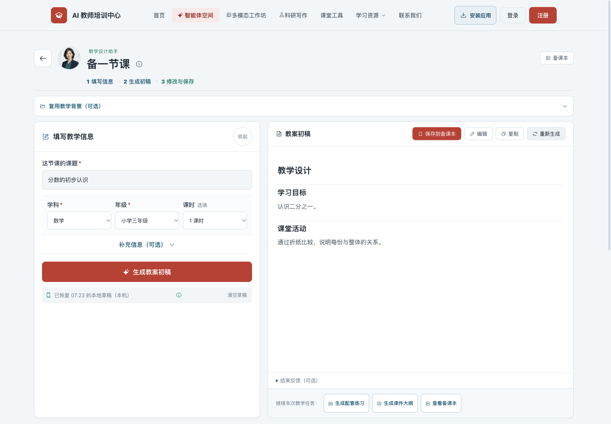
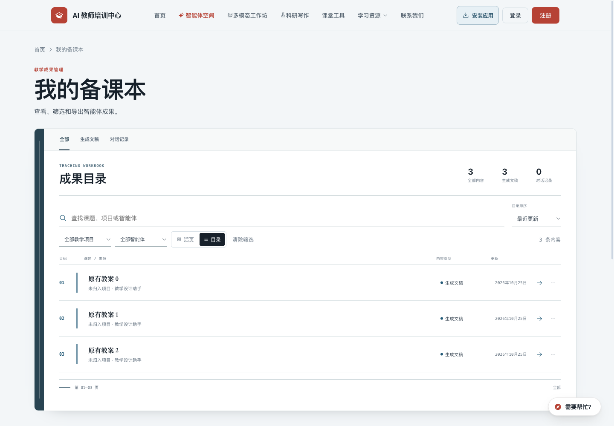
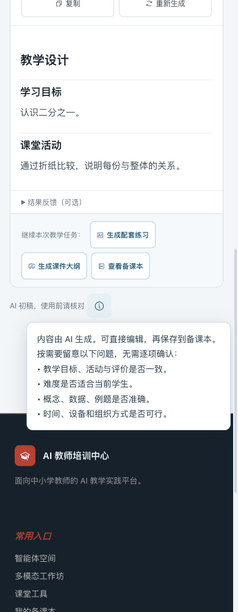

# 生成、修改与保存

状态：用户授权后已于 2026-10-28 上线，发布提交 `4c4ac31`。正式站：https://ai.teachailab.com/。

工作台：`http://127.0.0.1:8765/agents#lesson-design`。备课本：`http://127.0.0.1:8765/workspace`。下方截图使用隔离浏览器中的虚构账号和模拟教案，不操作真实数据。

## 修改

- 工作台移除四项“符合/需修改”、核验进度及完成状态，第三步为“修改与保存”；保存按钮只反映保存状态。
- 底部保留“AI 初稿，使用前请核对”，教材、学情、目标与课堂条件四类检查要点放入可选备注，无需确认。原有总体反馈独立为可选折叠项。
- 备课本移除待核验/已核验/待修改标签、核验统计和筛选，以及编辑表单里的核验状态选择；目录按内容类型呈现。
- 首页移除独立的使用前核验区；后台退役对应的首页与备课本文案字段，默认团队介绍改为初稿、修改与整理。自定义文案保留，仅迁移精确匹配旧默认值的内容。
- 原有作品和历史元数据不批量修改；新保存和编辑新版本不再写入旧核验字段。原稿与版本关联保留。
- 本机旧草稿仍可恢复；对旧版保存指纹做保守兼容，仅在内容与输入完全匹配时保留“已存入”标记，改过的内容不会误标为已保存。
- 生成失败时保留上一份完整正文，并仍允许修改与保存。实际模型信息继续在生成后显示，未调用模型时备注使用中性的“AI”。

## 验证

完整 `npm run check` 通过：函数 94 项、易用性 110 项、科研 249 项、来源 90 项等。新增行为断言覆盖旧保存指纹兼容、修改后不可误标、历史输入不变、新保存不带核验字段和旧作品只按内容类型显示。

隔离浏览器：320/390/768/1440px 的首页、工作台和备课本共 31 项布局及备注检查通过，无横向溢出和脚本错误。另完成编辑/保存失败与重试、保存直达、再次修改、模拟流式生成及失败恢复；备课本完成 10 项历史缓存、新版本保存、原稿保留与账号切换检查。两个初期操作脚本分别选中了生成后已折叠的按钮、遇到虚构认证的延迟登录弹层，调整测试操作后验证通过；被登录弹层遮挡的截图已重拍。

没有调用真实模型、发送邮件、创建真实登录会话或写入生产账号/作品。研究工具工坊的内容审查、模型提示词、课程匹配、权限与数据接口保持原样。

[浏览器检查记录](browser.json)。当前资源版本：site-copy/ux CSS `20261026-edit-save`，SW `20261026-v55-edit-save`；生产已同步。

临时截图、工具快照与隔离测试上下文已清理；用户要求的本地预览服务继续保留在 8765。

生产验证：完整私有回滚备份（数据库 gzip 3787750 字节、完整性通过）；候选/正式/公网接口守卫各 19 项，综合公网 170 项，发布文件哈希 222 项，HTTP/2、缓存、gzip、旧站保留路径与参数跳转和课程站等网络 9 项通过。38 个 API 文件一致，仅原子交换静态站，正式服务无重启；Nginx 配置不变。候选已删除，PM2 仅保留两个正式服务，systemd active/enabled。[生产验收记录](production.json)。

线上隔离浏览器 50 项通过：四种屏宽，生成后的编辑与保存、失败重试、已保存直达、再次编辑撤下成功状态、模拟流式生成与失败保留上次初稿、旧作品内容类型展示和新版本保留原稿/版本关联、账号切换、手机备注开关与屏幕边界。脚本错误 0，三张线上临时截图已查看；不调用真实模型、邮件或生产账号作品写入，运营写入被拦截。一次测试误把状态对象当字符串，修正断言后通过；详见 [线上浏览器记录](production-browser.json)。

发布 release 与完整私有备份保留；候选、QA 上下文、交换产生的旧目录、上传包、临时脚本/截图/快照与本机暂存已清理。用户既有 8765 本地预览继续保留。
